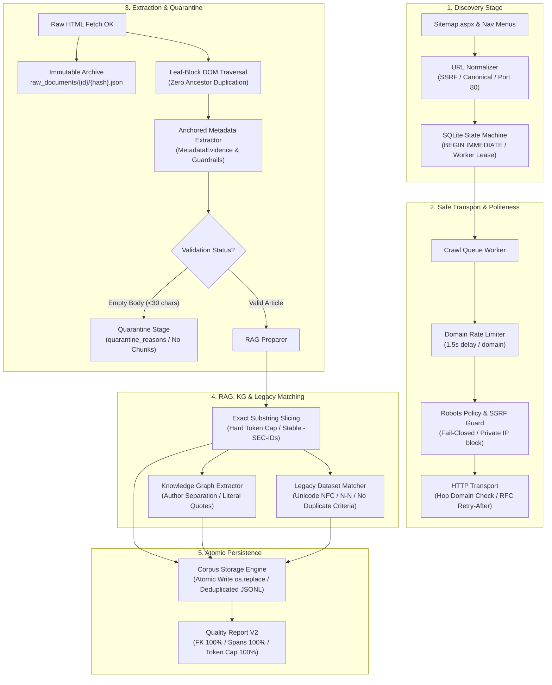

# Vietnamese Cultural Heritage Evidence Corpus: Post-Fix Architecture (Schema V2)

**Document Reference**: `ARCHITECTURE_AFTER_FIX.md`  
**System Version**: `2.0.0`  
**Target Domain**: National Museum of History (`https://baotanglichsu.vn`)  

---

## 1. Architectural Principles & Invariants

The post-fix system is engineered around four non-negotiable architectural invariants:

1. **Exact Substring Evidence Invariant**:  
   Every RAG section and entity mention must satisfy:
   $$\text{source\_text}[\text{char\_start}:\text{char\_end}] == \text{target\_text}$$
   No synthetic text, abstract prefixing, or unanchored string slicing is permitted.
2. **100% Foreign Key Resolvability**:  
   All entity mentions and KG candidate edges must reference a valid, existing `DocumentSection.section_id` in the form `{doc_id}-SEC-{idx:03d}`. No dangling foreign keys are tolerated.
3. **Ontological Strictness**:  
   Article authors are separated ontologically from artifact makers. Article journalists are represented as `(DOCUMENT) --[AUTHORED_BY]--> (PERSON)`. Artifact creation `(ARTIFACT) --[CREATED_BY]--> (PERSON)` is only emitted when explicit historical artisan text exists. Historical custody `(ARTIFACT) --[CURRENTLY_HELD_BY]--> (INSTITUTION)` requires literal verbatim custody text.
4. **Idempotence and Immutability**:  
   Raw HTML payloads are archived immutably under `raw_documents/{doc_id}/{content_hash}.json`. JSONL serialization uses atomic renaming (`os.replace`) and ID deduplication.

---

## 2. End-to-End Pipeline Architecture

---

## 3. Subsystem Breakdown

### 3.1. SQLite State Machine & Concurrency Control (`state_manager.py`)
- **Isolation Level**: Every claim is executed under `BEGIN IMMEDIATE` transaction semantics, preventing dual-worker collisions.
- **Worker Leases**: URL rows are locked with `worker_id`, `claimed_at`, and `lease_expires_at = now_utc + lease_seconds`.
- **Crash Recovery**: `recover_stale_processing(timeout_seconds=0)` detects expired leases on daemon startup and returns orphaned rows to `'queued'`.
- **Scheduled Backoff**: Failed URLs calculate `effective_delay = max(retry_after_header, base_delay * 2^(attempts-1))`. Rows are locked out from retrieval via `WHERE next_retry_at <= CURRENT_TIMESTAMP`.
- **Language Skips**: URLs matching unconfigured languages are marked `status = 'skipped_lang'` without inserting dummy rows into `crawled_documents`.

### 3.2. URL Normalization & SSRF Defense (`url_normalizer.py`)
- **Port Stripping**: Automatically recognizes default `:80` and `:443` ports on `baotanglichsu.vn`.
- **SSRF Defense**: Filters private RFC 1918 subnets, IPv6 loopback (`::1`), link-local (`169.254.0.0/16`), and explicit `localhost`.
- **Path Resolution**: Normalizes CMS slugs to stable logical document IDs: `VNMH-{LANG}-{CAT_ID}-{ARTICLE_ID}`.

### 3.3. DOM Leaf-Block Parser (`vnmh_parser.py`)
- **Elimination of Text Duplication**: Rather than calling `get_text()` on parent `
` elements (which re-concatenates child text blocks), the parser recursively locates only leaf block elements (`
`, `<li>`, `<blockquote>`, `<tr>`).
- **Anchored Metadata Extraction**: Extracted fields (`registration_number`, `material`, `dimensions`, `era_culture`, `storage_location`) must be anchored to explicit structural label tags (`<strong>Số đăng ký:</strong>`). Each field emits a `MetadataEvidence` entry tracking verbatim character bounds.
- **False-Positive Shields**:
  - Rejects single-letter material captures (e.g., English `"Materials:" -> "s"`).
  - Rejects dangling prepositions in eras (e.g., `"từ"`).
  - Supports multiline bulleted dimensions (`Cao: 98cm`, `Đường kính: 61cm`).

### 3.4. RAG Corpus Preparer (`rag_preparer.py`)
- **Substring Invariant**: Character offsets `[char_start:char_end]` are verified against `canonical_clean_text` on every emitted chunk.
- **Cap Compliance**: Chunks enforce `HARD_CAP_CHARS = 1600` (~400 tokens). Long paragraphs are split at sentence boundaries (`. `, `? `, `! `) or word boundaries without truncating words.
- **Stable Foreign Key Anchors**: Sections receive stable IDs: `{doc_id}-SEC-{idx:03d}`, establishing the canonical FK target for KG and citations.

### 3.5. Knowledge Graph Induction Engine (`kg_preparer.py`)
- **Ontological Separation**:
  - `(DOCUMENT) --[AUTHORED_BY]--> (PERSON)` for article journalists / staff authors.
  - `(ARTIFACT) --[CREATED_BY]--> (PERSON)` is strictly suppressed unless explicit ancient artisan text is present.
- **Zero Custody Fabrication**: `(ARTIFACT) --[CURRENTLY_HELD_BY]--> (INSTITUTION)` is only emitted when literal in-text evidence exists.
- **Literal Quote Mandate**: `evidence_quote` holds only literal source substrings, while algorithm explanations are stored in `derivation_note`.
- **Epistemic Labeling**: All algorithmically induced edges are marked `review_status = "PENDING_REVIEW"` and `epistemic_status = "ASSERTED"`.

### 3.6. Legacy Entity Matcher (`legacy_matcher.py`)
- **Safe Initialization**: If `crawled_artifacts_production.csv` is missing or inaccessible, the matcher transitions to `LEGACY_DATA_UNAVAILABLE` without crashing.
- **Unicode NFC Normalization**: Normalizes both legacy CSV records and incoming museum titles to NFC before calculating overlap tokens.
- **Multi-Attribute Verification**: Never matches on title alone; requires composite alignment of registration number, national treasure decree, and era/culture keywords.

### 3.7. Storage Engine (`storage.py`)
- **Atomic Operations**: All writes to JSON/JSONL write to PID-tagged temporary files (`.tmp.{pid}`) and rename atomically via `os.replace()`.
- **Immutable Raw Directory**: Raw payloads are filed under `raw_documents/{doc_id}/{content_hash}.json`.
- **Idempotent Appends**: In-memory and on-disk ID registries prevent duplicate rows when runs are resumed or replayed.
