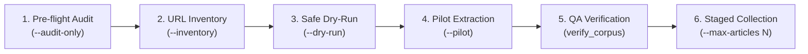

# Heritage Corpus Crawler: Operations Runbook & CLI Guide

**Document Reference**: `OPERATIONS_RUNBOOK.md`  
**Target Environment**: Staging / Production Research Infrastructure  
**CLI Runner**: `scraper/run_heritage_corpus.py`  
**Test Runner**: `scraper/heritage_corpus/run_all_tests.py`  
**Verification Tool**: `scraper/heritage_corpus/verify_corpus_integrity.py`  

---

## 1. Operating Workflow (Phased Execution)

Production execution must follow this strict sequence:



---

## 2. Standard Command Procedures

### 2.1. Pre-Flight Network & Policy Audit
Validates robots.txt, XML sitemap accessibility, and response headers:
```bash
python scraper/run_heritage_corpus.py --audit-only
```
- **Expected Exit Code**: `0`
- **Output**: Detailed latency, HTTP status, and robots directive assessment.

### 2.2. URL Inventory Compilation (Zero Body Downloads)
Explores Sitemap.aspx and navigation hubs to export `url_inventory.json` and `url_inventory.csv`:
```bash
python scraper/run_heritage_corpus.py --inventory
```

### 2.3. Safe Dry-Run (Discovery Only)
Validates traversal and queue ordering without downloading article bodies or altering corpus files:
```bash
python scraper/run_heritage_corpus.py --dry-run --max-discovery-pages 25
```
- **Manifest Status**: `DRY_RUN_COMPLETED`
- **Guarantee**: Zero writes to `parsed_documents.jsonl`, `raw_documents/`, or `crawled_documents`.

### 2.4. Bounded Pilot Crawl (5 Curated Articles)
Crawls the 5 curated baseline regression fixtures across Vietnamese and English:
```bash
python scraper/run_heritage_corpus.py --pilot --delay 1.5
```
- **Output**: Populates `scraper/heritage_corpus/data/` with verified Schema V2 datasets.

### 2.5. Offline Local Reprocessing (Zero Network)
Reprocesses raw HTML archives offline after code changes to update sections, mentions, and KG edges:
```bash
python scraper/run_heritage_corpus.py --reprocess-local --output-dir scraper/heritage_corpus/data
```

### 2.6. Automated QA Integrity Verification
Audits all datasets against the 6 formal acceptance gates (FK joins, exact slicing, quotes):
```bash
python scraper/heritage_corpus/verify_corpus_integrity.py scraper/heritage_corpus/data
```
- **Expected Verdict**: `[PASS] ALL INTEGRITY GATES MET` (Exit code `0`).

### 2.7. Automated Test Suite (28/28 Tests)
Executes all regression, reliability, and security tests:
```bash
python scraper/heritage_corpus/run_all_tests.py
```
- **Expected Result**: `28/28 Passed (100.0%)` (Exit code `0`).

### 2.8. Staged Production Collection
To run staged production collection with separate discovery and article quotas:
```bash
python scraper/run_heritage_corpus.py \
  --max-discovery-pages 50 \
  --max-articles 200 \
  --delay 2.0 \
  --lang vi,en \
  --output-dir scraper/heritage_corpus/data
```

---

## 3. Operational Troubleshooting Guide

### 3.1. Process Crash / Power Failure
- **Behavior**: URLs claimed by the dead worker remain marked `'processing'` until lease expiry.
- **Recovery**: On the next startup, `recover_stale_processing()` automatically detects expired leases and resets them to `'queued'`. No manual database cleanup is needed.

### 3.2. Server Returns HTTP 429 (Too Many Requests)
- **Behavior**: The crawler parses the `Retry-After` header (integer or HTTP-date), sets `next_retry_at`, and enters polite backoff.
- **Action**: Do not decrease `--delay`. Let the crawler respect the server-directed cooldown.

### 3.3. Document Quarantined
- **Behavior**: If an article page is empty or body text is under 30 characters, it is marked `validation_status = "QUARANTINED"` in `parsed_documents.jsonl` and skipped from RAG chunking.
- **Action**: Inspect `quarantine_reasons` in `parsed_documents.jsonl`. No corrupted data enters downstream RAG indexes.

### 3.4. Re-enabling Skipped Languages
If you initially crawled with `--lang vi` and now wish to include English (`--lang vi,en`):
```python
from heritage_corpus.state_manager import CorpusStateManager
mgr = CorpusStateManager("scraper/heritage_corpus/data/heritage_corpus_state.db")
mgr.requeue_skipped_languages(["en"])
```
This resets previously skipped English URLs back to `'queued'` without recrawling completed Vietnamese articles.
